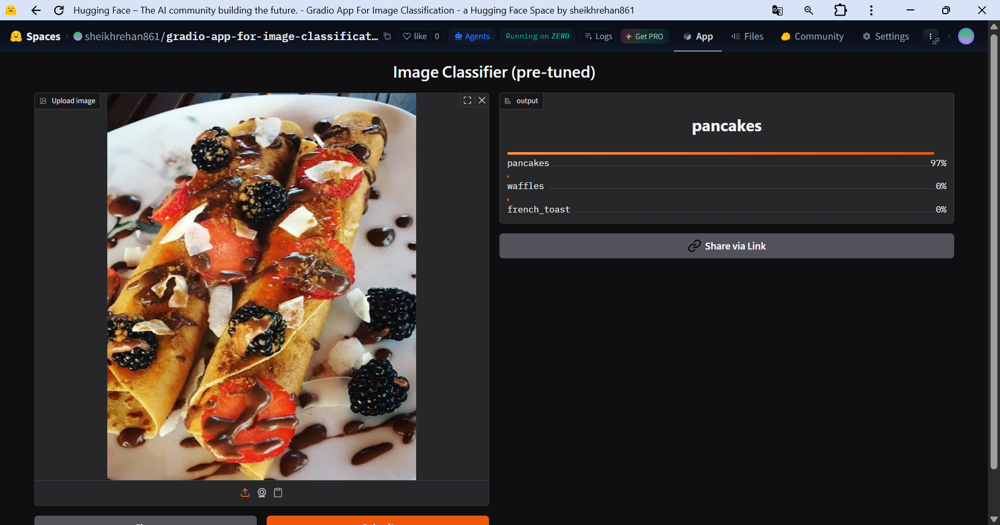
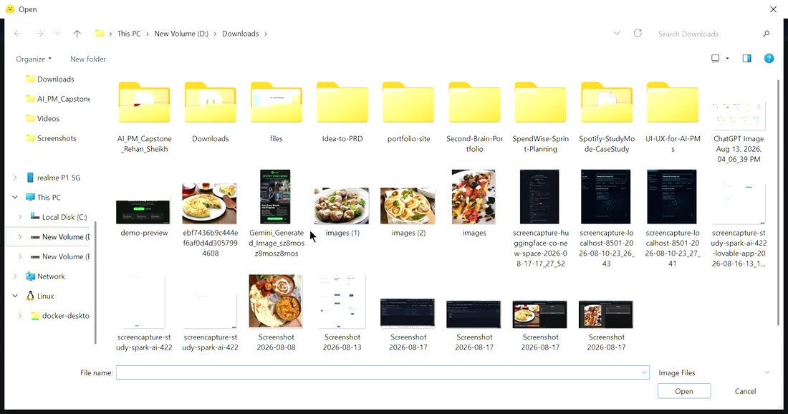
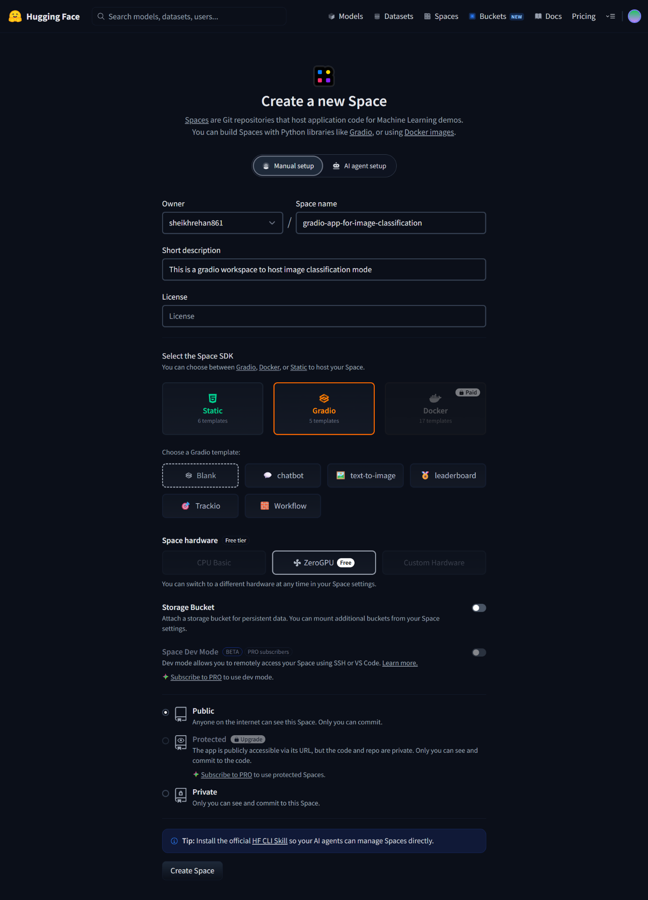

<div align="center">

# 🍽️ Food Image Classifier — Hugging Face Spaces

### Deploying a fine-tuned Vision Transformer behind a real, public Gradio app on serverless GPU infrastructure


-0984E3?style=flat-square)
-00B894?style=flat-square)
-E17055?style=flat-square)

**[🚀 Live Space](https://sheikhrehan861-gradio-app-for-image-classification.hf.space)**

</div>

---

## TL;DR

A short, focused exercise: take a pre-trained image classification model and get it running as a real, publicly accessible app — not just a local notebook. Deployed [`nateraw/food`](https://huggingface.co/nateraw/food) (a Vision Transformer fine-tuned on Food-101, 89.1% eval accuracy) behind a Gradio interface on Hugging Face Spaces, running on the free **ZeroGPU** serverless tier.

**Why this is here:** understanding model *deployment* — container builds, dependency pinning, serverless GPU allocation, inference latency — is a different skill from understanding model *architecture*, and one an AI PM benefits from having actually done once, not just read about.

---

## 📖 What It Does

Upload a food photo → the model classifies it and returns the top-3 predicted classes with confidence scores, rendered live via Gradio's `Label` component.

<p align="center">

</p>

<p align="center">

</p>

**The model:** [`nateraw/food`](https://huggingface.co/nateraw/food) — a `google/vit-base-patch16-224-in21k` Vision Transformer, fine-tuned on the [Food-101](https://huggingface.co/datasets/nateraw/food101) dataset (101 food categories, 89.13% accuracy on the eval set). Pre-trained and pre-tuned — the learning target here was the deployment pipeline, not training the model itself.

---

## 🎬 Demo

<p align="center">

</p>

<p align="center"><sub><a href="assets/classifier-demo-full.mp4">▶️ Full-length version (classifier-demo-full.mp4)</a></sub></p>

---

## 💻 The App

The entire inference app, `app.py`:

```python
import spaces
import gradio as gr
from transformers import pipeline

MODEL_ID = "nateraw/food"

clf = pipeline(
    "image-classification",
    model=MODEL_ID
)

@spaces.GPU
def predict(img):
    out = clf(img)

    # Show top-3 with scores
    out = sorted(
        out,
        key=lambda r: r["score"],
        reverse=True
    )[:3]

    return {
        r["label"]: float(r["score"])
        for r in out
    }

gr.Interface(
    fn=predict,
    inputs=gr.Image(type="pil", label="Upload image"),
    outputs=gr.Label(num_top_classes=3),
    title="Image Classifier (pre-tuned)"
).launch()
```

`requirements.txt`:
```
gradio
transformers
torch
pillow
spaces
```

**Two lines worth understanding, not skimming past:**
- `@spaces.GPU` — this decorator is what makes **ZeroGPU** work. It tells the Space to request a GPU on-demand *only* for the duration of this function call, rather than reserving one continuously. Without it, `spaces` has nothing to allocate against, and the Space would fall back to CPU-only inference for every request.
- `pipeline("image-classification", model=MODEL_ID)` — the entire model-loading and pre/post-processing complexity (image resizing, normalization, softmax, label mapping) is handled by one Transformers abstraction. The actual "ML code" here is intentionally thin; the real work in this exercise was everything *around* it — the Space config, the dependency file, reading what the container logs actually said.

---

## ⚙️ What Actually Happens on Deploy

**1. Space configuration** — Gradio SDK selected, and **ZeroGPU** chosen explicitly under "Space hardware" at creation time, not added later:

<p align="center">

</p>

**2. Container build** — installing the HF/Gradio stack, system dependencies (`ffmpeg`, `git-lfs`), and the pinned packages from `requirements.txt` inside a `python:3.10` Docker image:

<p align="center">

</p>

**3. Model + app startup** — pulling the actual `nateraw/food` weights (`pytorch_model.bin` / `model.safetensors`, 344MB — matching the model's real file size on the Hub), config, and preprocessor, then Gradio binding to a local port and going live:

<p align="center">

</p>

Worth reading, not just skimming past: `Device set to use cpu` — model *loading* happens on CPU; it's only the decorated `predict()` call that requests a GPU via ZeroGPU, per-request, on demand.

---

## 🚀 Setup Steps

1. Created and verified a Hugging Face account
2. Created a new Space — SDK: **Gradio**, Hardware: **ZeroGPU (free tier)**, visibility: **Public**
3. Created `app.py` with the code above, committed directly to `main`
4. Created `requirements.txt` with the 5 pinned dependencies, committed to `main`
5. Space auto-built and deployed — public URL live within a few minutes

---

## 🎓 What This Demonstrates

- **Deployment as its own skill, separate from modeling** — getting a model from "works in a notebook" to "a stranger can use this right now at a public URL" involves real infrastructure decisions (hardware tier, containerization, dependency pinning) that are easy to skip past when only ever training or testing models locally
- **Understanding what a decorator actually does, not just copying it** — `@spaces.GPU` isn't boilerplate here; it's the specific mechanism that makes serverless GPU allocation work, and knowing that is the difference between deploying successfully and debugging a mysteriously slow or failing Space
- **Reading logs as a diagnostic habit** — actually looking at build and startup logs, not just confirming "it works," is what surfaces details like CPU-only model loading before they become a surprise in production
- **Naming the actual model, not just "an AI model"** — being able to say *ViT-base fine-tuned on Food-101, 89.1% accuracy* instead of *"a pretrained classifier"* is a small habit that matters when a technical interviewer asks the obvious next question

---

<div align="center">

I'm a **Chemical Engineer transitioning into AI Product Management**, and I build and ship small, complete pieces like this one — including the unglamorous deployment mechanics — to learn product thinking by doing.

📂 More case studies and projects on my [GitHub profile](https://github.com/Rehansheikh787).

</div>
