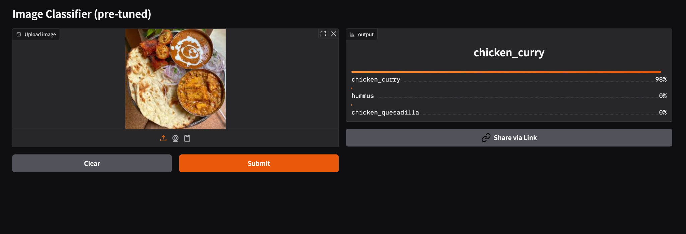
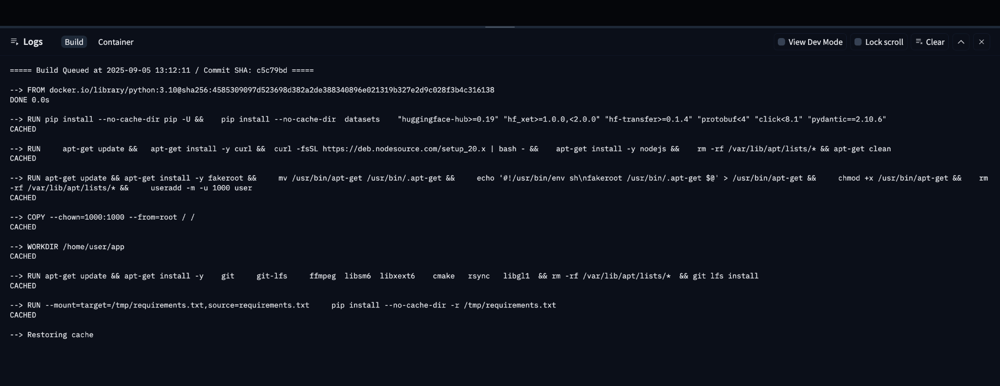
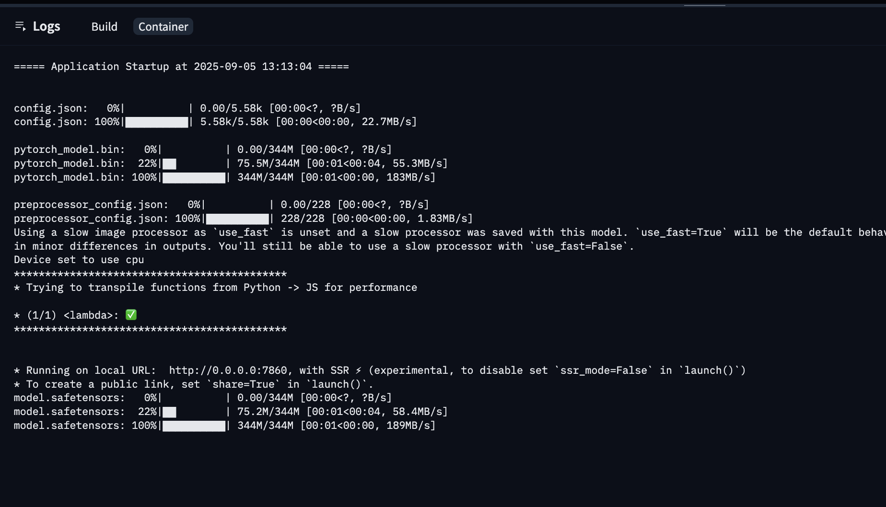

<div align="center">

# 🍽️ Food Image Classifier — Hugging Face Spaces

### A Gradio deployment of an existing Food-101 image classifier


-0984E3?style=flat-square)
-00B894?style=flat-square)
-E17055?style=flat-square)

**[Open the Hugging Face Space](https://huggingface.co/spaces/sheikhrehan861/gradio-app-for-image-classification) · [Watch the recorded demo](assets/classifier-demo-full.mp4)**

</div>

---

## Project overview

I deployed the existing `nateraw/food` Vision Transformer as a public Gradio app. I built the upload and results interface, configured the Hugging Face Space and its dependencies, inspected the build and startup logs, and checked sample uploads.

The upstream author fine-tuned the model on Food-101 and reports **89.13% accuracy on its evaluation set**. The app screenshots document individual predictions. [Upstream model card](https://huggingface.co/nateraw/food)

---

## 📖 What It Does

Upload an image to see the model's three highest-scoring Food-101 labels. Showing alternatives lets users see which other classes the model considered.

## Sample checks and a product limitation

The screenshots show two manual checks of the upload-to-result flow. The model ranked chicken curry first for one sample and pancakes first for the other. The percentages shown are model scores for those images.

<p align="center">

</p>

<p align="center">

</p>

**Unsupported-input example:** A photo of a keyboard is outside the Food-101 label set. The current workflow still ranks food labels for an accepted image because it has no unsupported-image check. A useful next experiment would measure how often users accept a wrong label on non-food images and dishes outside the label set, then test an explicit “I can’t identify this image” result.

---

## 🎬 Demo

<p align="center">

</p>

<p align="center"><sub><a href="assets/classifier-demo-full.mp4">▶️ Full-length version (classifier-demo-full.mp4)</a></sub></p>

---

## 💻 The App

The entire inference app, `app.py`:

```python
import spaces
import gradio as gr
from transformers import pipeline

MODEL_ID = "nateraw/food"

clf = pipeline(
    "image-classification",
    model=MODEL_ID
)

@spaces.GPU
def predict(img):
    out = clf(img)

    # Show top-3 with scores
    out = sorted(
        out,
        key=lambda r: r["score"],
        reverse=True
    )[:3]

    return {
        r["label"]: float(r["score"])
        for r in out
    }

gr.Interface(
    fn=predict,
    inputs=gr.Image(type="pil", label="Upload image"),
    outputs=gr.Label(num_top_classes=3),
    title="Image Classifier (pre-tuned)"
).launch()
```

`requirements.txt`:
```
gradio
transformers
torch
pillow
spaces
```

The Transformers pipeline handles model loading, image preprocessing, and label mapping. The `@spaces.GPU` decorator requests a ZeroGPU allocation for the decorated prediction call. [Hugging Face ZeroGPU documentation](https://huggingface.co/docs/hub/en/spaces-zerogpu)

---

## ⚙️ What Actually Happens on Deploy

**1. Space configuration** — Gradio SDK and ZeroGPU hardware selected during setup.

<p align="center">

</p>

**2. Container build** — the build logs show Python, system packages, and the dependencies listed in `requirements.txt`.

<p align="center">

</p>

**3. Model and app startup** — the logs show the model files downloading and Gradio starting.

<p align="center">

</p>

The startup log shows `Device set to use cpu`, and the app leaves the pipeline device at its default. Confirming GPU inference or a latency improvement would require a separate measurement.

---

## 🚀 Setup Steps

1. Created and verified a Hugging Face account
2. Created a public Space with the **Gradio** SDK and **ZeroGPU** hardware
3. Created `app.py` with the code above, committed directly to `main`
4. Added the Gradio, Transformers, PyTorch, Pillow, and Spaces dependencies in `requirements.txt`
5. Reviewed the Space build and startup logs and checked a sample upload

---

## 🎓 What This Demonstrates

- **Model integration** — deploy a named model behind an upload-to-result interface and verify the flow with sample images.
- **Deployment debugging** — read build and startup logs to check dependency installation, model loading, and app startup.
- **Product risk** — identify how a closed set of labels can mislead users and define a test for an unsupported-image result.

---

<div align="center">

I'm a **Chemical Engineer transitioning into AI Product Management**, and I build and ship small, complete pieces like this one — including the unglamorous deployment mechanics — to learn product thinking by doing.

📂 More case studies and projects on my [GitHub profile](https://github.com/Rehansheikh787).

</div>
